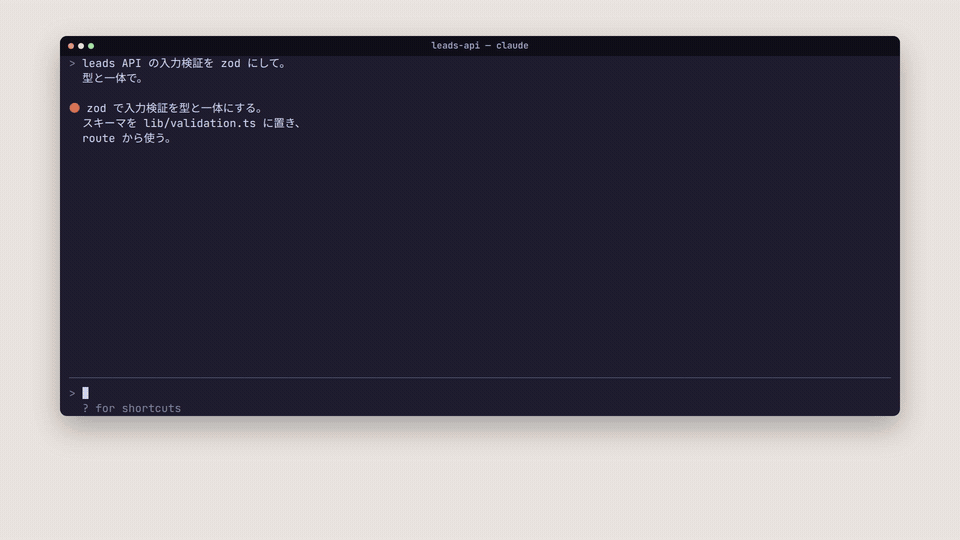

# claude-cockpit

AI が書くのを、計器で見る。Claude Code の mod。

AI にコードを書かせている間、人がやることは「書く」ではなく「見る」に変わった。何が変わり、何に効き、壊れていないか。
それを transcript から目を離さずに知るための計器盤を、右に 1 枚足す。左の Claude Code は素のまま。



[音声つきの MP4(日本語ナレーション・英語字幕)](media/cockpit-intro.mp4)

| mod | 何をするか |
|---|---|
| [cockpit](./cockpit) | 書かれている最中のコードが流れる。確定したら本当の差分(変わった行と前後だけ)。そのファイルの imports / dependents と、このセッションで増えた依存。編集直後の型チェック・テストの結果。履歴をさかのぼって、その時の画面に戻る。`o` で VS Code の該当行へ、`r` でリバート |

## インストール

Claude Code のプロンプトで:

```
/plugin install cockpit --marketplace rintaroyamaoka/claude-cockpit
```

シェルから:

```
claude plugin install cockpit --marketplace rintaroyamaoka/claude-cockpit
```

`Add marketplace?` に `y`、scope は user を選ぶ。

## 開発

```
claude --plugin-dir ./cockpit        # そのセッションだけ読み込む(保存で再読み込み)
claude plugin validate ./cockpit     # manifest と hooks module の検証
claude plugin test ./cockpit         # 純粋なロジックの単体テスト
npm run typecheck                    # tsc --noEmit(npx で typescript を取る。npm の依存は持たない)
```
